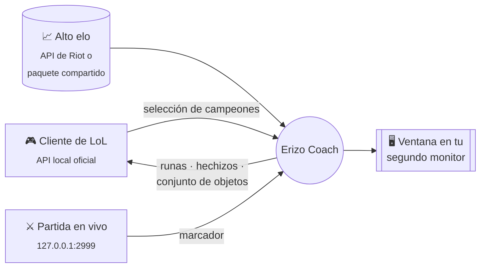

<p align="center">
  
</p>

<p align="center">
  
  
  
  
  
</p>

<p align="center">
  <b>Te pone las runas, los hechizos y la build en cuanto eliges campeón</b>, adaptados a los rivales y<br>
  a lo que de verdad juegan los jugadores de alto elo. Durante la partida, en tu segundo monitor,<br>
  te dice <b>qué comprar ahora</b> y <b>quién va fuerte</b> en cada línea.
</p>

<p align="center">
  
  <br><sub>La ventana real de Erizo Coach en la selección de campeones: previsión, runas puestas solas y otra página elegida con un clic.</sub>
</p>

---

## ✨ En la selección de campeones

<table>
<tr>
<td width="50%" valign="top">

### 🎯 Runas y hechizos solos
- **Preselecciona 5 segundos** y tus runas y hechizos ya están puestos en el cliente.
- **Al último pick** se ajustan a los rivales que ya se ven (salvo lo que hayas cambiado tú).
- **Base de alto elo**: lo que más se juega con tu campeón y posición de Diamante II a
  Challenger, en EUW, Corea y Norteamérica; si faltan datos, la recomendación de Riot.
- **Destello se queda en tu tecla** (D o F).
- **Aplastar solo en la jungla**: yendo a la jungla es obligatorio (en la D o en la F) y en
  cualquier otra posición no se puede poner, tampoco desde la ventana.

### 🔀 3 páginas para elegir
La recomendada y las otras piedras angulares más jugadas, con sus partidas y su
% de victorias. Tocar una la pone en el cliente.

### 🥊 Counters contra tu rival de línea
En cuanto el rival de tu línea elige, los **5 campeones a los que mejor les va contra
él** en tu posición, sacados de los enfrentamientos de las partidas de alto elo. Solo
los que puedes elegir (tuyos, sin banear ni coger). Con pocas partidas el porcentaje
se acerca a la media del campeón, para que un 3 de 3 no parezca un 100 %. Cuando
bloqueas, cómo va tu enfrentamiento.

</td>
<td width="50%" valign="top">

</td>
</tr>
<tr>
<td width="50%" valign="top">

</td>
<td width="50%" valign="top">

### ✏️ Cámbialas desde la ventana
- **Runas**: abre el editor y toca la que quieras, como en el cliente. Se escribe al
  momento en tu página «Erizo Coach». Si cambias de árbol, el resto se recoloca solo para
  que la página siga siendo válida.
- **Hechizos**: toca el de la D o el de la F y elige otro de los de tu modo. Si eliges
  el de la otra tecla, se intercambian.
- **Lo que cambies tú se respeta**: ni la app ni el último pick lo vuelven a tocar para
  ese campeón.

### 🛒 La build en la tienda
Un conjunto de objetos «Erizo Coach» con lo inicial, las botas, el núcleo en orden y lo que
pide el equipo enemigo, listo en la pestaña *Conjuntos de objetos*.

### 🔎 Cada objeto, a fondo
- **Nombres a la vista**: los objetos y las runas llevan su nombre, sin pasar el ratón.
- **Toca un objeto** y se dibuja su composición (los componentes van apareciendo nivel a
  nivel) con **qué comprar primero** y por qué. En partida marca lo que ya llevas y te dice
  qué toca **ahora**.
- **Déjalo pulsado** (o clic derecho) y verás todo lo que da: estadísticas, pasivas y activas.

</td>
</tr>
</table>

## ⚔️ Durante la partida

<p align="center">
  
</p>

<table>
<tr>
<td width="50%" valign="top">

### 💰 Qué comprar ahora
1. **Al empezar**, lo inicial junto: *Anillo de Doran + 2 pociones*.
2. **El núcleo de tu build, sin desvíos**, y lo que empezaste, se termina.
3. **Antisanación barata** si quien se cura mucho está en tu línea (solo el componente).
4. **Con el núcleo hecho**, la respuesta a la mayor amenaza (defensa o antisanación).

Con lo que te falta de oro, una barra que se llena y qué componentes ya puedes comprar.
Los objetos que se mejoran solos (Abrazo del serafín, Muramana...) cuentan como hechos.

</td>
<td width="50%" valign="top">

</td>
</tr>
<tr>
<td width="50%" valign="top">

</td>
<td width="50%" valign="top">

### 📊 Quién va fuerte, línea a línea
- Arriba, el **oro total de cada equipo y su diferencia**, como en las retransmisiones.
- Una fila por línea: **tu compañero, la diferencia de oro y su rival**.
- **Verde ◄** si va por delante tu compañero, **rojo ►** si el rival, **=** si van igualados.
- Cada jugador con KDA, súbditos, nivel, tipo de daño y una etiqueta
  **Muy fuerte / Fuerte / Normal / Por detrás**.
- **Oro total conseguido, en directo** (se actualiza cada segundo): tiempo de partida,
  súbditos, monstruos, asesinatos, asistencias, primera sangre y torres; lo que no se ve
  (placas, recompensas, objetivos) se corrige solo cada vez que alguien compra.
- Si el juego no dice las líneas (a ciegas, práctica), se deducen por campeón.

</td>
</tr>
</table>

<details>
<summary><b>📱 También en una ventana estrecha</b></summary>
<br>
<p align="center"></p>
</details>

## 🧭 Cómo funciona



- **Solo la API local y oficial** del cliente y de la partida (`127.0.0.1`): no lee la memoria
  del juego, no inyecta nada y no automatiza nada dentro de la partida. Compatible con
  Vanguard y con las normas de Riot para aplicaciones de terceros.
- **Solo información visible en el marcador** durante la partida.

---

<details>
<summary><b>🧩 Runas y hechizos, en detalle</b></summary>

- **Detecta sola el cliente de LoL** (aunque lo abras después que la app, o lo cierres y lo
  vuelvas a abrir) y se conecta de forma **segura**, verificada con el certificado oficial de Riot.
- **Sigue la selección de campeones en tiempo real**: tu posición, quién bloquea qué campeón,
  baneos, intercambios, dodges y el momento en que **se hace el último pick**.
- **Previsión al preseleccionar**: en cuanto preseleccionas o miras un campeón, la ventana
  enseña las runas y hechizos que le pondrá (para tu posición asignada).
- **Preselección mantenida**: si te quedas 5 segundos en un campeón, se ponen ya en el cliente
  (provisionales).
- **Al hacerse el último pick, te pone las runas y los hechizos** (en el mismo segundo):
  1. **Base**: las runas y hechizos que más usan los jugadores de alto elo con tu campeón
     y posición (si hay estadísticas suficientes); si no, la recomendación oficial de Riot
     para tu campeón, posición y mapa (se actualiza sola con cada parche).
  2. **Rival de línea por probabilidad**: se prueban todos los repartos posibles de los
     enemigos en las líneas según las posiciones habituales de cada campeón.
  3. **Ajustes explicados**, solo cuando hay un motivo claro:

     | Situación | Ajuste |
     |---|---|
     | Equipo enemigo con mucho control | Fragmento de Tenacidad |
     | Eres frágil y tu rival de línea es un asesino de daño explosivo | Fragmento de Vida |
     | Llevas la fila 2 de Valor | Revestimiento de huesos (vs. asesinos) o Fuerzas renovadas (vs. castigo a distancia) |
     | Tirador contra 3+ campeones con control fuerte | Limpiar |
     | Apoyo contra 2+ asesinos muy móviles | Extenuación |
     | Mago frágil y sin movilidad contra un asesino en medio | Barrera en vez de Teleportar |
     | Jungla | Aplastar, siempre |

  4. **Si no se ven los enemigos** (selección a ciegas) **o no está claro tu rival**, se
     usan las runas y hechizos por defecto para tu campeón, sin ajustes de línea.
- **Lo que cambies tú** (en la ventana o en el cliente) no se vuelve a tocar para ese
  campeón. Solo vuelve a aplicar si cambia tu campeón (intercambio o banquillo de ARAM).
- En ARAM usa las recomendaciones de ARAM (Destello + Marca). En modos sin runas no toca nada.

**Tu página de runas**: la app usa **una sola página propia**, llamada «Erizo Coach: (campeón)».
Si existe, la reescribe; si no, la crea si tienes un hueco libre. Si no hay hueco, **solo
reutiliza una página vacía y no válida** (sin nombre): nunca toca tus otras páginas. Si no
hay ninguna opción, no cambia las runas y te las muestra para que las pongas tú (los
hechizos sí se aplican). Para darle una página, renombra una a «Erizo Coach».

</details>

<details>
<summary><b>🛒 La build en la tienda, en detalle</b></summary>

En el mismo momento, la app escribe un **conjunto de objetos «Erizo Coach: (campeón)»**, que
verás en la tienda de la partida, pestaña *Conjuntos de objetos*:

| Bloque | Contenido |
|---|---|
| Inicio | Objetos iniciales según tu posición (Doran, objeto de apoyo, mascota de jungla, objeto de guardián en ARAM) |
| Botas | Las de tu tipo de campeón (o las defensivas, si eres de primera línea y hace falta) |
| Núcleo (en orden) | Los 3 objetos clave, en orden de compra |
| Contra este equipo | Objetos que pide el equipo enemigo, con su componente barato delante |
| Build completa | 6 objetos: botas + núcleo + los 2 mejores huecos según los enemigos |
| Mejora de apoyo | La mejora del Atlas mundial adecuada (solo apoyos) |

**De dónde sale la build** (Riot no ofrece builds recomendadas en el cliente):

1. **Estadísticas de alto elo** (ver abajo): con 20 partidas o más de tu campeón y posición,
   la build que de verdad hacen (inicio, botas y los 3 primeros objetos en su orden real).
2. **Si faltan datos, reglas por tipo de campeón**: con su perfil oficial (roles, tipo de
   daño) se clasifica en uno de 10 tipos (mago de daño explosivo, tirador de críticos,
   luchador, tanque, apoyo encantador...), con excepciones para builds especiales (Smolder,
   Kai'Sa, Ezreal, Jhin...). Todos los objetos se **validan contra el parche actual**.
3. **Adaptación a los enemigos**, con el motivo:

   | Situación | Qué añade (según tu tipo de campeón) |
   |---|---|
   | Enemigos que se curan mucho (Soraka, Aatrox, Vladimir...) | Antisanación: Morellonomicón, Recordatorio letal, Mecanoespada punki o Malla de espinas |
   | Supresiones (Malzahar, Skarner, Warwick, Urgot) | Cimitarra mercurial / Bendición de Mikael |
   | 3+ enemigos de daño mágico | Velo del hada, Cimitarra, Fauces, Rostro espiritual, Rookern kaénico... |
   | 3+ enemigos de daño físico | Zhonya, Ángel de la guarda, Baile de la muerte, Randuin... |
   | 2+ asesinos muy móviles | Zhonya, Arcoescudo inmortal, Bendición de Mikael |
   | 2+ tanques | Bastón del Vacío, Recuerdos de lord Dominik, Cuchilla negra |
   | 2+ campeones con muchos escudos | Colmillo de serpiente |
   | Eres de primera línea | Botas de mercurio o blindadas según el daño enemigo |

**Tus conjuntos de objetos están a salvo**: el cliente solo permite reemplazar la lista
entera, así que la app la lee, cambia solo el conjunto «Erizo Coach» y comprueba después que
los tuyos siguen ahí. Si faltara alguno, restaura la lista original.

</details>

<details>
<summary><b>📈 Estadísticas de alto elo (API oficial de Riot)</b></summary>

1. **Clave**: consigue tu clave gratuita en [developer.riotgames.com](https://developer.riotgames.com)
   y guárdala con `uv run erizocoach stats clave`. Se pide sin mostrarse y se guarda **cifrada en
   el Administrador de credenciales de Windows**. Nunca aparece en pantalla ni en los registros.
   La de desarrollo caduca cada 24 h; para no renovarla, pide una clave personal siguiendo
   [docs/clave-personal-riot.md](docs/clave-personal-riot.md).
2. **Descarga automática**: con la app abierta, descarga sola en segundo plano hasta tener
   20.000 partidas del parche. Descarga de **EUW, Corea y Norteamérica a la vez**: Riot limita
   la clave en cada región por separado, así que salen unas 1.500 partidas por hora en cada
   una. **Se pausa en la selección de campeones y durante la partida** y sigue al volver al
   menú. Recorre jugadores Challenger, Gran Maestro, Maestro, Diamante I y Diamante II (primero
   los de Maestro o más), toma sus partidas clasificatorias del parche actual y
   guarda de cada jugador solo campeón, posición, resultado, compras en orden, runas y hechizos
   (**sin nombres, Riot ID ni identificadores**). Respeta los límites de Riot y no repite
   partidas. Con un parche nuevo vuelve a empezar y borra los parches viejos. Si la clave
   caduca, te avisa en la ventana. También se puede lanzar a mano con
   `uv run erizocoach stats descargar` (con la app cerrada).
3. **Uso**: tras cada tanda de descarga se recalcula, sin reiniciar, la build más habitual de
   cada campeón y posición, sus runas (las 3 piedras angulares más elegidas y, entre quienes
   llevan cada una, lo más elegido de cada fila) y sus hechizos. Con 20 partidas o más
   sustituyen a las reglas y a la recomendación de Riot; los ajustes contra los enemigos se
   aplican encima. Si el parche es muy nuevo y aún hay pocas partidas, usa las del anterior.
4. **Sin clave**: se descargan solas las **estadísticas compartidas** que publica quien sí
   tiene clave (un archivo pequeño, sin datos de jugadores, validado antes de usarlo). Así
   un amigo tiene las mismas builds sin configurar nada. Ver
   [docs/estadisticas-compartidas.md](docs/estadisticas-compartidas.md).

La ventana indica de dónde salen las runas y la build, por ejemplo
«estadísticas de 392 partidas de alto elo (parche 16.22)».

</details>

<details>
<summary><b>🖥️ La ventana, en detalle</b></summary>

Erizo Coach es una **aplicación de escritorio**: su ventana (con su nombre e icono) se abre
**centrada en tu segundo monitor** (1056 × 700, o lo que quepa), y al cerrarla se cierra la app.
Durante la partida se actualiza cada 3 segundos.

**Abrir League of Legends**: con el cliente cerrado, la ventana tiene un botón que lo abre. Abre el cliente de Riot como su acceso directo y, en cuanto tienes la sesión iniciada, le pide el LoL por su API local (lo mismo que su botón «Jugar»), porque si el cliente de Riot ya estaba abierto su acceso directo solo lo pone delante.

**Intro al abrirlo**: al pulsar ese botón, tu monitor principal se llena durante unos 5 segundos con una intro propia (bandas de cine, el medallón del erizo cayendo con onda expansiva y chispas, «LEAGUE OF LEGENDS» letra a letra en oro) y luego se desvanece. No te quita el teclado, los clics la atraviesan (si el cliente de Riot aparece antes, puedes usarlo) y no sale en la barra de tareas. Con las animaciones de Windows desactivadas solo hay fundidos. Se quita con `launch_intro = false`.

**Segundo plano**: el botón **Segundo plano** de la cabecera esconde la ventana (tampoco sale
en la barra de tareas) y Erizo Coach **sigue funcionando igual**: runas, hechizos, build en la
tienda y descarga de estadísticas. Mientras tanto la ventana no se repinta, así que no gasta.
Para volver, haz clic en el **icono de Erizo Coach junto al reloj** de Windows (puede estar dentro
de la flechita ˄) o abre Erizo Coach otra vez. Con clic derecho en ese icono también puedes
cerrarlo.

**Oro**: como en las retransmisiones de Riot, es el **oro total conseguido** (gastado o no).
Ese dato solo lo tiene el servidor de la partida y la API local de Riot da únicamente el tuyo
sin gastar; del resto se ve lo mismo que en el marcador. Así que se calcula con todo lo que
da oro y se puede ver (valores oficiales de los parches 26.01-26.03):

| Fuente | Cómo se cuenta |
| --- | --- |
| Inicial y pasivo | 500 de oro y 20,4 cada 10 s desde el 1:05 (igual para todos) |
| Súbditos | 18,7 de media por súbdito hasta el 15:00 y hasta 21,5 desde el 25:00 (más cañones) |
| Monstruos de la jungla | 24 por monstruo para quien lleva Aplastar |
| Asesinatos | 300 (rival de nivel 1-6) a 420 (nivel 18), +100 la primera sangre |
| Asistencias | La mitad de la recompensa, repartida entre los que ayudan |
| Torres | El oro global para todo el equipo (50 exteriores y del nexo, 25 interiores e inhibidores) |
| Lo que no se ve | Placas, rachas, recompensas por ir por detrás, objetos de apoyo, dragones, Barón...: el valor de los objetos de un jugador nunca supera el oro que ha conseguido, así que cuando compra, lo que faltaba se le suma para el resto de la partida |

Tu oro es exacto (tus objetos más tu oro sin gastar). Se lee la partida cada segundo.

**Quién va fuerte**: se combina el oro de cada jugador (60 %), su KDA (25 %) y su nivel (15 %)
frente a la media de la partida. En los primeros 3 minutos no se etiqueta a nadie. La
diferencia de oro de la tarjeta de líneas es frente a su rival de posición.

**Qué comprar**, por este orden:
0. **Objetos iniciales**: al empezar la partida, con el inventario vacío, todo lo de inicio junto.
1. **Antisanación barata**, la única que se adelanta al núcleo: solo el componente (Orbe del
   olvido, Llamada del verdugo...), nunca el objeto entero. En fase de líneas (hasta el
   14:00), solo si quien se cura está en tu línea.
2. **Termina lo que empezaste**: si ya tienes componentes de un objeto, se acaba ese.
3. **El núcleo de tu build** (con las botas tras el primer objeto), sin desvíos.
4. Con el núcleo hecho, la respuesta a la mayor amenaza: defensa si un enemigo que hace mucho
   daño va muy fuerte (o tu rival de línea va fuerte), o la antisanación completa. En fase
   de líneas solo cuentan los enemigos de tu línea (en la inferior, tirador y apoyo).
5. El resto de tu build.

**Diseño**: estilo *liquid glass* con los colores de League (dorado y azul marino):
tarjetas translúcidas con desenfoque y brillo en los bordes sobre un fondo con profundidad.
Todo el texto cumple el contraste AA. Las animaciones son cortas y ligeras para no restar
rendimiento a la partida; se reducen si Windows tiene reducidos los efectos de movimiento, y
la transparencia se quita si pides menos transparencia.

**Seguridad de la ventana**: es una ventana nativa (pywebview, con el motor WebView2 que
Windows 11 trae de serie) que habla con la app **directamente, sin servidor ni puerto abierto**.
La página solo puede pedir cinco cosas (el estado, el icono de un objeto, campeón, runa o
hechizo por su id, pasar a segundo plano y poner otras runas u otros hechizos, que la app
valida antes de escribir) y se carga con una política estricta: solo su propio código (con
un *nonce* nuevo en cada arranque), iconos incrustados y ninguna conexión de red.

Si faltara WebView2, Erizo Coach usa como respaldo Edge en modo aplicación con un servidor local
(solo `127.0.0.1`, clave aleatoria, `Host` y `Origin` comprobados y cabeceras estrictas).

</details>

## 🚀 Cómo se usa

**Con la aplicación instalada**: abre **Erizo Coach** desde el menú Inicio o el acceso directo del
escritorio. Para salir, cierra su ventana (o, si está en segundo plano, clic derecho en su
icono junto al reloj → *Cerrar Erizo Coach*).

**Descargarlo o pasárselo a otra persona**: la última versión está siempre en
[Releases](https://github.com/eriizzo/ErizoCoach/releases/latest)
(`Instalar-Erizo-Coach-<versión>.exe`), un solo archivo que se instala con doble clic (sin
permisos de administrador) y se desinstala desde *Aplicaciones instaladas*. Guía para quien lo
instala: [docs/instalar-en-otro-pc.md](docs/instalar-en-otro-pc.md).

**Actualizar**: cuando hay una versión nueva, la ventana enseña «Erizo Coach X disponible» con
el botón **Actualizar** (solo con el LoL cerrado, en el menú o en la sala; nunca en cola, en la
selección ni en partida). Un clic la descarga, comprueba que está **firmada por el autor**,
cierra la app, la instala sin preguntas y la vuelve a abrir. La app lo mira 30 s después de
abrirse y luego cada 6 horas; se quita con `update_check = false`.

<details>
<summary><b>Instalar o actualizar desde el código</b></summary>

Desde una terminal en esta carpeta; requiere [uv](https://docs.astral.sh/uv/):

```bash
uv run python scripts/make_icon.py   # (solo si cambias el icono) assets/erizocoach.ico
uv run python scripts/build_exe.py   # crea dist/Erizo Coach/ con los ejecutables
uv run python scripts/install.py     # lo instala con accesos directos (--desinstalar para quitarlo)
uv run python scripts/build_installer.py  # instalador de un archivo para pasárselo a otra persona
```

**Publicar una versión** (solo el autor): tras el commit, la etiqueta `vX.Y.Z` y subirlos,

```bash
uv run python scripts/publicar_version.py --crear-clave  # una vez: clave de firma (privada en Windows)
uv run python scripts/publicar_version.py --token        # una vez: token fine-grained de GitHub
uv run python scripts/publicar_version.py                # construye, firma y publica la release
```

El token es *fine-grained*, solo para este repositorio y con el permiso *Contents: Read and
write*; se guarda cifrado en el Administrador de credenciales, igual que la clave privada de
firma (la pública está en `src/erizocoach/update/signing_key.py`). El script comprueba que no
hay cambios sin guardar y que la etiqueta apunta al commit actual también en GitHub, crea la
release como borrador, sube instalador, firma y manifiesto, y solo entonces la publica.

Se instala en `%LOCALAPPDATA%\Programs\Erizo Coach` (sin permisos de administrador) con dos
ejecutables: **`Erizo Coach.exe`** (la aplicación, sin consola) y **`erizocoach-consola.exe`** (los
comandos de texto, por ejemplo `erizocoach-consola.exe stats descargar`). Tus datos están aparte, en
`%LOCALAPPDATA%\ErizoCoach`, y no se tocan al actualizar ni al desinstalar. Si venías de una
versión con el nombre antiguo (LoL Coach, hasta la 0.20), su carpeta `%LOCALAPPDATA%\LoLCoach` y tu
clave de Riot guardada pasan solas al nombre nuevo la primera vez que abres la app.

</details>

<details>
<summary><b>Comandos y configuración</b></summary>

```bash
uv run erizocoach             # la app con su ventana de escritorio
uv run erizocoach --check     # comprueba la conexión con el cliente y sale
uv run erizocoach --debug     # muestra también los mensajes técnicos
uv run erizocoach --demo      # abre la ventana con una partida de ejemplo (para verla sin jugar)
uv run erizocoach --browser   # ventana con Edge en lugar de la de escritorio
uv run erizocoach --no-window # sin ventana (solo consola)
uv run erizocoach stats clave          # guarda tu clave de la API de Riot (cifrada)
uv run erizocoach stats descargar      # descarga partidas de alto elo (--horas 2, --partidas N)
uv run erizocoach stats estado         # cuántas partidas hay descargadas
uv run erizocoach stats olvidar-clave  # borra la clave guardada
uv run erizocoach stats publicar       # publica ya tus estadísticas para quien no tiene clave
```

Con la ventana de escritorio, al cerrarla se cierra Erizo Coach. En modo `--browser` o
`--no-window` se sale con **Ctrl+C**.

Los registros se guardan en `%LOCALAPPDATA%\ErizoCoach\logs\erizocoach.log`
(máximo 4 MB, rotativos). Configuración opcional en `%LOCALAPPDATA%\ErizoCoach\config.toml`:

```toml
league_dir = "D:/Riot Games/League of Legends"  # solo si no se detecta sola
debug = false
discovery_interval = 3  # segundos entre intentos de detectar el cliente
auto_runes = true       # false = solo recomendar las runas, sin aplicarlas
auto_spells = true      # false = solo recomendar los hechizos, sin aplicarlos
auto_item_set = true    # false = solo mostrar la build, sin ponerla en la tienda
window = true           # false = sin ventana del segundo monitor
window_on_secondary = true  # false = abrir la ventana en el monitor principal
window_mode = "escritorio"  # "navegador" = usar Edge en lugar de la ventana de escritorio
window_on_top = false       # true = ventana siempre encima
launch_intro = true         # intro de 5 s en el monitor principal al abrir el LoL desde la app
update_check = true         # false = no mirar si hay versiones nuevas
live_poll_interval = 1  # segundos entre lecturas de la partida (1-10)
riot_region = "euw1"    # tu región: euw1, eun1, tr1, na1, kr
stats_regions = ["euw1", "kr", "na1"]  # regiones de las que se descargan partidas
stats_min_games = 20    # partidas mínimas para usar la build de estadísticas (5-500)
stats_auto_download = true   # descargar estadísticas solo, con la app abierta
stats_target_matches = 20000 # partidas por parche a partir de las que se para (200-100000)
stats_shared = true          # sin clave (o con pocos datos): usar las estadísticas compartidas
```

</details>

## 🛡️ Seguridad y normas de Riot

- Solo usa la API **local y oficial** del cliente (`127.0.0.1`). No lee la memoria del
  juego, no inyecta nada y no automatiza acciones dentro de la partida: es compatible
  con Vanguard y con las normas de Riot para aplicaciones de terceros.
- Los datos del juego (campeones, runas, objetos, recomendaciones) los da el propio cliente,
  en tu idioma y de tu parche. Lo único que va a Internet es la descarga de estadísticas
  (de la API de Riot con tu clave, o el paquete compartido público) y, si lo configuras, la
  publicación de ese paquete. **Nada tuyo** (Riot ID, partidas, claves) sale de tu PC.
- La conexión TLS **solo confía en la autoridad de certificación de Riot**
  (`src/erizocoach/lcu/certs/riotgames.pem`) y verifica que el certificado es para
  `127.0.0.1`. Si otro programa intentara hacerse pasar por el cliente, se rechaza.
- La contraseña temporal del cliente nunca se muestra ni se guarda en los registros.
  La sesión de la selección (que incluye tu Riot ID y credenciales del chat) tampoco.
- Cada página de runas se **valida antes de enviarla**: si algo no cuadra, se usa la de
  Riot o no se envía nada. Cada objeto de la build se valida contra el parche.
- Tus páginas de runas y tus conjuntos de objetos no se tocan (ver arriba).
- Solo puede haber una copia abierta (evita aplicar runas dos veces).
- Las actualizaciones solo se instalan si su manifiesto está **firmado con la clave del autor**
  (Ed25519; la privada no sale de su PC) y el instalador descargado tiene exactamente el tamaño
  y el SHA-256 firmados. Solo se descarga por HTTPS de `github.com` y `*.githubusercontent.com`:
  aunque alguien entrara en la cuenta de GitHub, no podría colar una actualización.
- Una prueba automática comprueba, con el cliente abierto, que su contraseña temporal no
  aparece en ningún archivo del proyecto.

<details>
<summary><b>🏗️ Estructura del código</b></summary>

```
src/erizocoach/
  __main__.py          Punto de entrada y opciones
  app.py               Montaje de módulos y diagnóstico (--check)
  bus.py               Bus de eventos interno (los módulos se comunican por eventos)
  events.py            Catálogo de eventos: el "contrato" entre fases
  monitor.py           Traduce los eventos del cliente en eventos de la app
  lcu/                 Conexión con el cliente: detección, TLS, HTTP, websocket, reconexión
  champselect/         Modelo, lectura y seguimiento de la selección de campeones
  gamedata/            Datos del juego leídos del cliente: campeones, perfiles, runas, hechizos
  loadout/             Posiciones, reglas, recomendación y aplicación de runas/hechizos
  builds/              Tipos de campeón, builds base, adaptación y conjunto de objetos
  ingame/              Lectura de la partida en vivo, quién va fuerte y qué comprar
  stats/               Clave, API de Riot, descarga (también automática), agregación,
                       paquete compartido y fuente de builds, runas y hechizos
  ui/console.py        Mensajes en consola
  ui/desktop.py        Ventana de escritorio (pywebview) y puente directo con la app
  ui/tray.py           Icono en la bandeja de Windows para el segundo plano
  ui/web/              Interfaz (HTML/CSS/JS), presentador, iconos, servidor de respaldo y demo
assets/                Icono de la aplicación (generado con scripts/make_icon.py)
packaging/             PyInstaller, información de versión del .exe e instalador (installer.py)
scripts/               Construir el .exe, instalarlo, crear el instalador, el icono y las capturas
tests/                 Pruebas automáticas: cliente de LoL simulado y datos reales del parche
docs/                  Guías y las imágenes de este README (docs/img)
```

Cada función nueva se engancha a los eventos existentes (`PicksFinalized`,
`MyChampionChanged`, `LoadoutApplied`, `LoadoutInClient`, `BuildApplied`...) sin modificar
lo anterior. Las reglas (`loadout/rules.py`, `builds/rules.py`) son funciones puras: se
pueden ampliar, o sustituir por IA en un plan de pago, sin tocar el resto. La build base
llega por `BuildSource`: hoy, estadísticas reales con las reglas como respaldo.

</details>

## 🧪 Desarrollo

```bash
uv run pytest                             # pruebas
uv run ruff check .                       # revisión de estilo y errores comunes
uv run python scripts/capturas_readme.py  # rehace las capturas y animaciones de este README
```

Las capturas se hacen con la **ventana real** (el mismo presentador, HTML, CSS y animaciones
que la app) y Edge sin ventana, con datos del parche, iconos de CommunityDragon (copia pública
de los archivos del cliente) y las estadísticas compartidas de alto elo. No necesita el
cliente abierto.

## 🗺️ Hoja de ruta

1. **Conexión y lectura de la selección de campeones** ✅
2. **Runas y hechizos automáticos al hacerse el último pick** ✅
3. **Build inicial en la tienda, adaptada a la composición enemiga** ✅
4. **Ventana en el segundo monitor durante la partida: quién va fuerte y qué comprar** ✅
5. **Builds afinadas con estadísticas reales de alto elo (API oficial de Riot)** ✅
6. **Runas y hechizos de alto elo, descarga automática y guía de clave personal** ✅
7. **Diseño liquid glass de la ventana** ✅
8. **Segundo plano con icono en la bandeja y equipos ordenados por línea** ✅
9. **Estadísticas compartidas: builds de alto elo también sin clave de Riot** ✅
10. **Runas con imágenes, editables en la ventana y puestas al mantener la preselección** ✅
11. **Compras con el núcleo primero, objetos mejorados y objetos iniciales** ✅
12. **3 páginas de runas para elegir, hechizos editables y oro por línea** ✅
13. **Más partidas de alto elo (Diamante II+, EUW, KR y NA)** ✅
14. **Oro total en directo, como en las retransmisiones** ✅
15. **Counters contra tu rival de línea en la selección** ✅
16. **Aplastar obligatorio en la jungla y prohibido en las demás posiciones** ✅
17. **Erizo Coach: nuevo nombre, logo y botón para abrir el LoL** ✅
18. **Intro al abrir el LoL y botón «Actualizar» con versiones firmadas** ✅
19. Siguientes mejoras posibles: IA opcional (de pago), historial de tus partidas.

## ⚖️ Aviso legal

Erizo Coach no está respaldado por Riot Games y no refleja las opiniones de Riot Games ni de
nadie que participe oficialmente en la producción o gestión de las propiedades de Riot Games.
Riot Games y todas sus propiedades asociadas son marcas comerciales o marcas registradas de
Riot Games, Inc.

*Erizo Coach isn't endorsed by Riot Games and doesn't reflect the views or opinions of Riot
Games or anyone officially involved in producing or managing Riot Games properties. Riot Games,
and all associated properties are trademarks or registered trademarks of Riot Games, Inc.*
